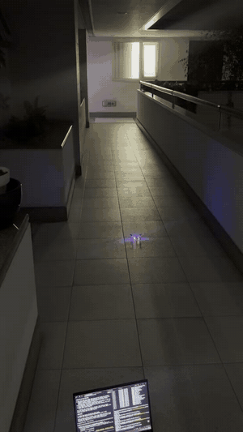

# 3DDSG Drone Navigation

An indoor drone (**Crazyflie 2.1 + Flow deck**) that uses an IFC-based **3D Dynamic Scene Graph (3DDSG)** as its map:
given "go from room A to room C", it plans a route and flies it without collisions.

This repo covers the part that **takes the graph and flies the drone**. Graph construction and lab data are not included.

## Progress

| Step | Description | Status |
|---|---|---|
| 0 | Setup, Crazyflie connection, hover / forward flight | Done |
| 1 | Goal parsing + route planning on a fake graph | Planned |
| 2 | Collision check with Open3D visualization | Planned |
| 3 | Real-drone test (virtual walls) | Planned |
| 4 | Connect the real graph (Neo4j) | Planned |
| 5 | Re-planning for dynamic objects | Planned |

## Setup

Crazyflie 2.1 + Flow deck v2 + Crazyradio PA, Windows, Python 3.12. On Windows, install the Crazyradio libusb driver with Zadig.

```
py -3.12 -m venv cf-env
cf-env\Scripts\activate
pip install cfclient neo4j networkx numpy open3d
```

## Scripts

| File | Description |
|---|---|
| `step0_prop_test.py` | Firmware propeller test, no take-off |
| `step0_hover_test.py` | Take off, hover, move forward, land |

```
cf-env\Scripts\python step0_hover_test.py --height 0.3 --distance 0.5 --hover-time 3
```

It refuses to take off unless:
- the Flow deck is detected (`deck.bcFlow2`),
- the battery is at least 3.7 V,
- the drone is not locked, crashed or tumbled (`supervisor.info`),
- the ground height sensor reads below 80 mm and is not frozen.

It logs height, motor outputs, x/y and yaw during flight.

## Step 0 results

Good lighting, textured floor. Values are the drone's own estimates; real distances were not measured.

| Flight | Max height | Commanded forward | Estimated forward |
|---|---|---|---|
| Hover at 0.3 m | 0.33 m | - | about 6 cm drift |
| Hover at 0.3 m + forward | 0.33 m | 0.5 m | 0.62 m |
| Hover at 1.0 m + forward | 1.07 m | 0.3 m | 0.68 m |

Height overshoots the target by 2 to 7 cm, and yaw drifts by up to about 10 degrees (the Flow deck heading is gyro-based).

The position estimate seemed more accurate when flying higher (1 m) than lower (0.3 m). This was an observation during the flights and has not been verified with real measurements.

## Lessons learned: flying in the dark

<p align="center">
  
  <br>
  <sub>Flight attempt in the dark · <a href="docs/media/night_flight.mp4">mp4</a></sub>
</p>

In the dark, the drone lost its orientation and crashed. The optical flow sensor needs floor texture and light; without them the position estimate diverged, the height sensor froze at 201 mm, and the motors saturated.

Fly with **good lighting** and a **textured floor**. The Flow deck's valid height range is 0.2 to 3.0 m, and it cannot detect obstacles.

## References

- [Crazyflie 2.1](https://www.bitcraze.io/products/old-products/crazyflie-2-1/)
- [Motion Commander guide](https://www.bitcraze.io/documentation/repository/crazyflie-lib-python/master/user-guides/sbs_motion_commander/)
