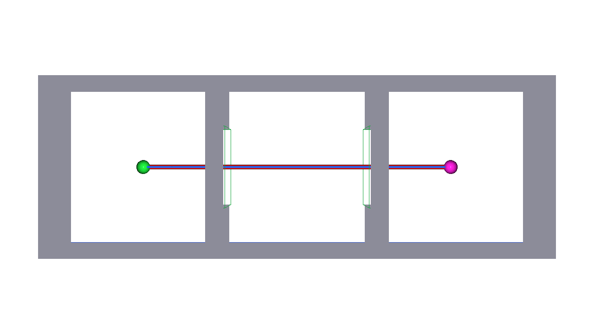
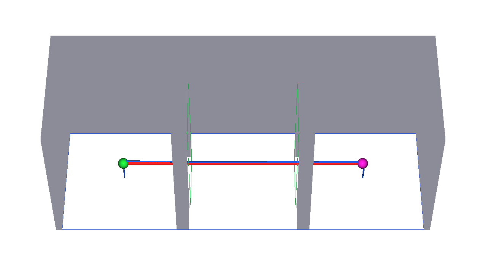
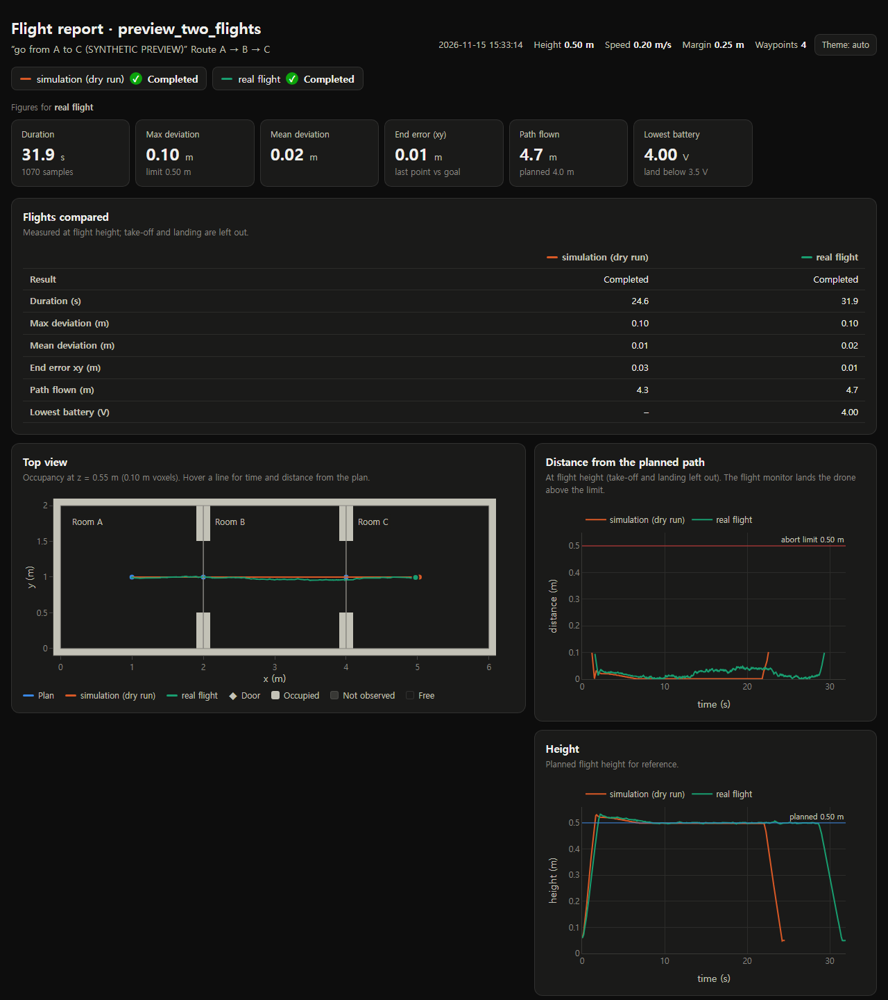
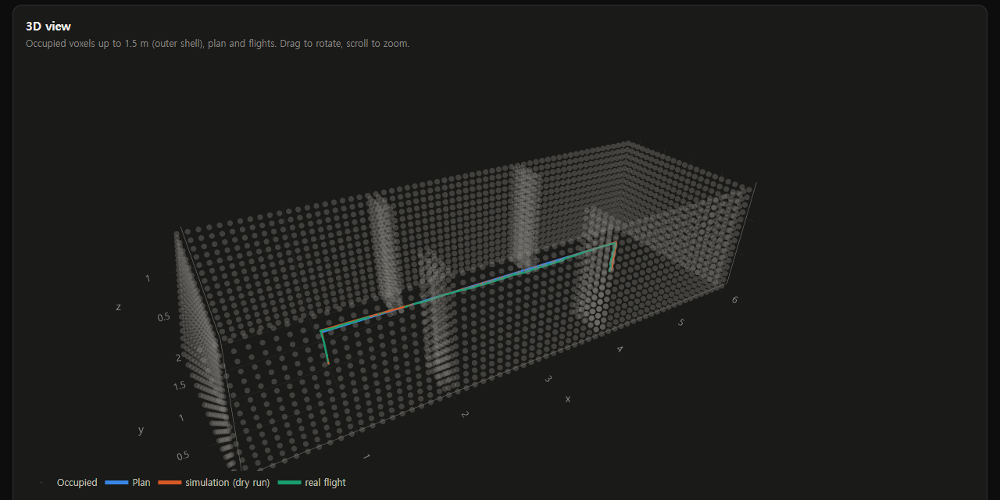
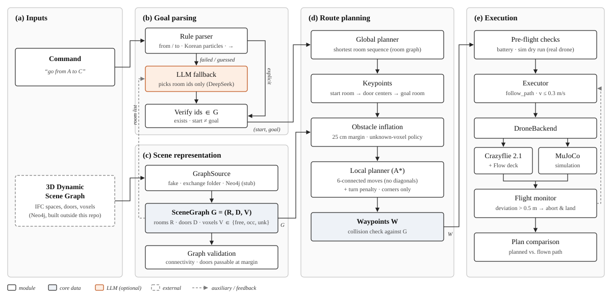

# 3DDSG Drone Navigation

<p align="center">
  
  <br>
  <sub>Our first flight in the dark. It lost its way, which is why "bright room" is rule number one below. · <a href="docs/media/night_flight.mp4">mp4</a></sub>
</p>

An indoor drone (**Crazyflie 2.1 + Flow deck**) that uses an IFC-based **3D Dynamic Scene Graph (3DDSG)** as its map: given "go from room A to room C", it plans a route and flies it without collisions.

This repo is the part that **takes the graph and flies the drone**. Graph construction and lab data are not part of it.

## Status

| Step | |
|---|---|
| 0 Setup, hover and forward flight | Done on the real drone |
| 1 Goal parsing, route planning | Done |
| 2 Collision check, visualization | Done |
| 3 Virtual-room flight | Simulation, flight monitor and comparison done. **Real flight pending** |
| 4 Real graph (Neo4j) | **Open: needs the graph export or schema** |
| 5 Dynamic objects, re-planning | Not started |

<p align="center">
  
  
  <br>
  <sub>Step 3 in simulation: three virtual rooms sized to the real flying space, "go from A to C". Red is the planned route, blue the simulated flight. Start is green, goal magenta, doors are green outlines.</sub>
</p>

## Run it

Windows, Python 3.12. Real flights need a Crazyflie 2.1 with Flow deck v2 and a Crazyradio PA (libusb driver via Zadig).

```
py -3.12 -m venv cf-env
cf-env\Scripts\activate
pip install cfclient
pip install -e ".[neo4j,viz,sim,live,dev]"
pytest                      # 183 tests, about 2 minutes, no drone needed

cf-env\Scripts\python scripts\fly_route.py --backend sim --rooms 2 2 2 --depth 2 "go from A to C"
```

**Optional LLM for goal parsing.** Copy `.env.example` to `.env` and set `DDSG_LLM_API_KEY`. It uses DeepSeek by default; any OpenAI-compatible API works if you change `DDSG_LLM_BASE_URL` and `DDSG_LLM_MODEL`. Without a key, only the rules run. `.env` is never committed.

## Flight dashboards

<p align="center">
  
  
  <br>
  <sub>The flight report for "go from A to C". Blue is the plan, orange the simulation dry run, green the real flight. <b>The green "real flight" here is synthetic</b> (the simulated track with added drift and a falling battery) to show the layout: the real drone has not flown a route yet.</sub>
</p>

Every `fly_route.py` run is saved to `runs/<time>/` (git-ignored) with a **flight report**:

- **`report.html`**: one page per run with the plan, the simulation dry run and the real flight side by side.
  It shows a top view on the occupancy map, distance from the plan and height over time, battery, a 3D view, and the event log (take-off, waypoints, drone state changes, monitor abort, landing).
  It loads Plotly from a CDN; `--offline` embeds it instead.
- **Live view (`--live`)**: the map, the plan and the drone in [Rerun](https://rerun.io) while it flies. Position, distance from the plan, height, and on the real drone battery and state (locked, crashed, tumbled) update about 10 times a second from its 20 Hz log.
  The simulation then runs at wall-clock speed. The stream is also saved as `runs/<time>/flight.rrd`.

```
cf-env\Scripts\python scripts\fly_route.py --backend sim --live "go from A to C"
cf-env\Scripts\python scripts\flight_report.py runs\<time> --open    # rebuild and open a report
cf-env\Scripts\python scripts\flight_report.py runs --all            # every run
cf-env\Scripts\python scripts\replay_run.py runs\<time>              # replay a run in Rerun
```

A run folder holds `run.json` (plan; per flight: result, comparison, status samples, events), `graph/` (the map flown on) and `flight_N.csv` (trajectories).
It can contain lab graphs: share the report, not the folder.

## How it fits together

<p align="center">
  
</p>

**Figure 1.** System overview. A command (a) becomes a start and goal room (b): the rule parser runs first, and the optional LLM is asked only when the rules fail or had to guess. It can only pick rooms that exist in the scene graph. The scene graph (c) comes from the 3DDSG, which is built outside this repo. Route planning (d) finds a room sequence, then a collision-free voxel path with a 25 cm margin. Execution (e) flies the waypoints on the real drone or in MuJoCo, checks after every waypoint and lands if the drone drifts off the plan.

- **Goal parsing** (`goal.py`, `llm_goal.py`): rules for `from A to C`, `A방에서 C방으로`, `A -> C`. With an API key set, phrases the rules cannot resolve ("회의실 옆 방으로", "에이방에서 씨방으로") go to an LLM, which only picks room ids. The answer is checked against the graph, and route planning never depends on it. The scripts print which parser was used.
- **`SceneGraph`** (`graph/model.py`): rooms, doors and a voxel map (free / occupied / unobserved). Everything downstream uses only this. A graph comes from a `GraphSource`: the fake graph, or a folder in the exchange format ([docs/graph_format.md](docs/graph_format.md)).
- **Planning** (`planner/`): room sequence over the room graph, then A* on the voxels door to door, with a 25 cm safety margin. Unobserved voxels count as obstacles by default (`planner/policy.py`).
- **Flight** (`flight/`): `follow_path` flies a path through a **`DroneBackend`**: the real Crazyflie (`backends/crazyflie.py`) or MuJoCo (`backends/mujoco_backend.py`). Speed is capped at 0.3 m/s and the drone always lands.
- **Records**: `flight/record.py` collects status and events during `follow_path` and saves the run folder; `report.py` builds the HTML report, `viz/live.py` the Rerun view.
- **Checks**: `flight/safety.py` before take-off, `flight/monitor.py` after every waypoint, `validate.py` for a graph (`scripts/graph_tools.py validate <folder>` explains why a graph cannot be planned on).

## Where help is needed

- **Step 4, Neo4j source** (`graph/neo4j_source.py`, a documented stub): produce a `SceneGraph` for one floor. The contract is in the file and in `docs/graph_format.md`. Until the schema is known, an export in that format works with everything here.
- **Unobserved voxels**: the policy is one setting for the whole map. Real data may need it per element type (an unobserved wall vs an unobserved door).
- **Step 5**: dynamic objects are not in the model yet.
- **Real flights**: `backends/crazyflie.py` is **not flight-tested**; only `scripts/step0_hover_test.py` was flown.

## Before flying the real drone

- **Bright room, textured floor.** In the dark the optical flow sensor fails: the position estimate diverged, the drone lost its orientation and crashed. Valid height is 0.2 to 3.0 m. The Flow deck cannot see obstacles.
- **Run the simulation first.** `fly_route.py --backend crazyflie` does a simulated dry run and refuses to fly if it touches a wall.
- Start at **0.3 m** with a short route. Keep a hand near the drone; Ctrl+C lands it.
- Charged battery (take-off needs 3.7 V). After any crash, check the battery, propellers and deck pins.
- The simulator has no sensor model: it does **not** reproduce Flow deck drift or failures.

## Working together

- Do not push to `main`. Make a branch, open a Pull Request, and run `pytest` first.
- **Never commit lab data** (graphs, IFC, point clouds). `data/` is ignored.
- Keep `main` working: tests pass, scripts run from the repository root.

## Layout

```
src/ddsg_nav/   graph/  goal.py  llm_goal.py  validate.py  planner/  sim/  flight/ (backends/)  viz/  report.py
scripts/        fly_route.py  flight_report.py  replay_run.py  graph_tools.py  step0_hover_test.py  ...
tests/          run without a drone
data/           local graphs, never committed
runs/           flight records and reports, never committed
docs/           graph_format.md, media/
```
