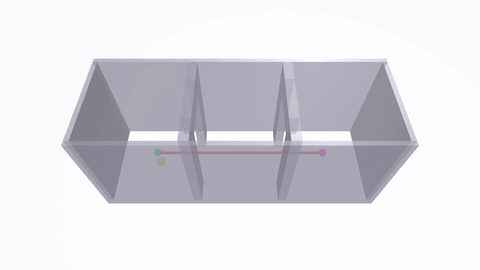
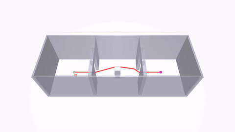

# 3DDSG Drone Navigation

An indoor drone (**Crazyflie 2.1 + Flow deck**) that uses an IFC-based **3D Dynamic Scene Graph (3DDSG)** as its map: given "go from room A to room C", it plans a route and flies it without collisions.

This repo is the part that **takes the graph and flies the drone**. Graph construction and lab data are not included.

| Step | Status |
|---|---|
| 0 Setup, hover and forward flight | Done |
| 1 Goal parsing, route planning | Done |
| 2 Collision check, Open3D visualization | Done |
| 3 Virtual-room flight | Simulation, flight monitor and plan-vs-flown comparison done; real flight pending |
| 4 Real graph (Neo4j) | Waiting for the graph export or schema |
| 5 Re-planning for dynamic objects | Planned |

## Quick start

Windows, Python 3.12, Crazyflie 2.1 + Flow deck v2 + Crazyradio PA (install its libusb driver with Zadig).

```
py -3.12 -m venv cf-env
cf-env\Scripts\activate
pip install cfclient
pip install -e ".[neo4j,viz,sim,dev]"
pytest

cf-env\Scripts\python scripts\fly_route.py --backend sim --rooms 2 2 2 --depth 2 "go from A to C"
cf-env\Scripts\python scripts\fly_route.py --backend crazyflie --rooms 2 2 --depth 2 "A -> B"   # real drone
```

<p align="center">
  
  
  <br>
  <sub>MuJoCo simulation. Red: planned route · blue: flown trail · orange: drone · <a href="docs/media/sim_flight.mp4">mp4</a>, <a href="docs/media/sim_flight_obstacle.mp4">mp4</a></sub>
</p>

## How it works

- **Graph**: rooms, doors and a voxel map (free / occupied / unobserved). Every data source produces the same `SceneGraph`, so the planners do not change with it.
- **Planning**: room sequence over the room graph, then A* on the voxels door to door, with an exact 25 cm safety margin. Unobserved voxels count as obstacles by default; `free` and `free_in_rooms` are options.
- **Flight**: `follow_path` talks to a `DroneBackend` (real Crazyflie or MuJoCo). Speed is capped at 0.3 m/s and the drone always lands. Pre-flight checks cover the Flow deck, battery, drone state and height sensor; a monitor checks battery, state, position and distance from the plan after every waypoint.
- **Checked in simulation**: all 36 plans (6 room pairs, 3 heights, with and without an obstacle) have zero collisions. A simulated flight stays within 0.1 m of its plan.

The simulation has no sensor model, so it does **not** reproduce Flow deck drift or failures in the dark. The real-drone backend is **not flight-tested yet**.

## Real data

Real data is not available yet. Export one floor as a folder (`graph.json` + `voxels.npz`, see [docs/graph_format.md](docs/graph_format.md)) and check it:

```
cf-env\Scripts\python scripts\graph_tools.py validate <folder>
cf-env\Scripts\python scripts\graph_tools.py route <folder> "401호에서 302호로 가줘"
```

`validate` explains why a graph cannot be planned on (blocked or unreachable doors, rooms with no flyable space, isolated rooms, mostly unobserved map). Rooms can be polygons and have aliases (room number, IFC id). Planning a 30 m x 20 m floor takes 0.14 s at 0.1 m voxels; one A* over the whole floor would take 42 s.

## Flight results (Step 0)

Good lighting, textured floor. All values are the drone's own estimates; real distances were not measured.

| Flight | Max height | Commanded forward | Estimated forward |
|---|---|---|---|
| Hover at 0.3 m | 0.33 m | - | about 6 cm drift |
| Hover at 0.3 m + forward | 0.33 m | 0.5 m | 0.62 m |
| Hover at 1.0 m + forward | 1.07 m | 0.3 m | 0.68 m |

Height overshoots by 2 to 7 cm and yaw drifts up to about 10 degrees (the heading is gyro-based).

## Lessons learned: flying in the dark

<p align="center">
  
  <br>
  <sub>Flight attempt in the dark · <a href="docs/media/night_flight.mp4">mp4</a></sub>
</p>

In the dark the drone lost its orientation and crashed: the position estimate diverged, the height sensor froze at 201 mm and the motors saturated. The optical flow sensor needs light and floor texture. Valid height is 0.2 to 3.0 m, and the Flow deck cannot see obstacles.

## Layout

```
src/ddsg_nav/   graph/  goal.py  validate.py  planner/  sim/  flight/ (backends/)  viz/
scripts/        fly_route.py  graph_tools.py  render_sim_video.py  viz_routes.py  demo_sim.py
                benchmark_planning.py  step0_hover_test.py  step0_prop_test.py
tests/          run without a drone
data/           lab graphs, never committed
docs/           graph_format.md, media/
```

## References

- [Crazyflie 2.1](https://www.bitcraze.io/products/old-products/crazyflie-2-1/)
- [Motion Commander guide](https://www.bitcraze.io/documentation/repository/crazyflie-lib-python/master/user-guides/sbs_motion_commander/)
