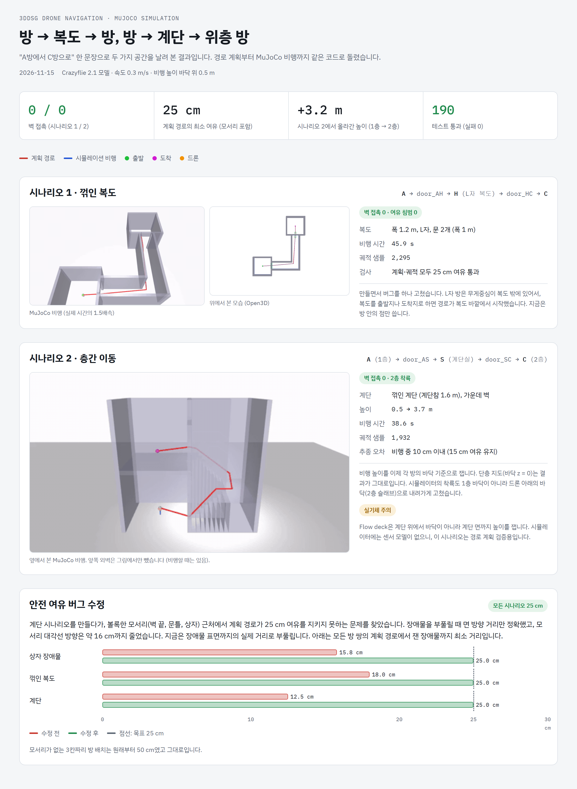

# 3DDSG Drone Navigation

<p align="center">
  
  <br>
  <sub>어두운 곳에서 한 첫 비행. 위치를 잃고 추락했습니다. 아래 "실기체 비행 전에"의 첫 규칙이 "밝은 방"인 이유입니다. · <a href="docs/media/night_flight.mp4">mp4</a></sub>
</p>

**"A방에서 C방으로 가"라고 말하면, 작은 드론이 건물 지도를 보고 길을 정해서 벽에 부딪히지 않고 날아가는 프로그램입니다.**

실내 드론(**Crazyflie 2.1 + Flow deck**)이 IFC 기반 **3D Dynamic Scene Graph(3DDSG)**를 지도로 씁니다. 이 저장소는 그래프를 받아서 **계획하고 드론을 날리는 부분**입니다. 그래프를 만드는 일과 연구실 데이터는 포함하지 않습니다.

## 이 프로젝트가 하는 일

처음 가 보는 건물에서 "401호에서 302호로 가세요"라는 말을 들었을 때 사람이 하는 일을 드론이 하게 만든 것입니다.

| 사람이 하는 일 | 이 프로젝트에서 | 상태 |
|---|---|---|
| 말을 알아듣는다 | 명령 문장에서 출발방과 도착방을 뽑습니다 | 완료 |
| 건물 지도를 본다 | 3DDSG(방, 문, 벽 정보)를 읽습니다 | 가짜 그래프와 파일 형식만 됨 |
| 길을 정한다 | 방 순서를 정하고, 벽에서 25cm 떨어진 경로를 계산합니다 | 완료 |
| 걷는다 | 드론이 경로를 따라 날고, 벗어나면 착륙합니다 | 시뮬레이션만 됨 |

## 지금 상태

| 단계 | 내용 | 상태 |
|---|---|---|
| 0 | 셋업, 호버링, 전진 비행 | 실제 드론으로 완료 |
| 1 | 명령 해석, 경로 계획 | 완료 |
| 2 | 충돌 검사, 시각화 | 완료 |
| 3 | 가상 방 비행 | 시뮬레이션, 비행 모니터, 비교 완료. **실제 비행은 아직** |
| 4 | 실제 그래프(Neo4j) 연결 | **열려 있음: 그래프 내보내기 파일이나 스키마가 필요** |
| 5 | 움직이는 물체, 경로 재계획 | 시작 전 |

<p align="center">
  
  <br>
  <sub>시뮬레이션 결과. 영상: <a href="docs/media/sim_corridor.mp4">시나리오 1</a> · <a href="docs/media/sim_stairs.mp4">시나리오 2</a> · <code>render_sim_video.py --corridor</code> / <code>--stairs --cutaway</code></sub>
</p>

## 해야 할 과제

과제는 **[GitHub Issues](https://github.com/isopink/3ddsg-drone-navigation/issues)**에서 관리합니다. 과제마다 목적, 건드릴 파일, 완료 기준이 적혀 있습니다.

- **센서와 호버 안정화**: Flow deck 높이 센서 문제 확인
- **실제 경로 비행 검증**: `backends/crazyflie.py`는 실제 비행 검증을 거치지 않았습니다
- **Neo4j 그래프 연결**: `graph/neo4j_source.py`가 스텁입니다
- **미관측 복셀 정책**: 벽, 문 같은 요소별로 다르게 처리
- **동적 객체와 재계획**: 움직이는 물체는 아직 모델에 없습니다

## 시작하기

직접 설치할 필요 없이, 저장소를 받은 뒤(`git clone`, 또는 GitHub의 **Code → Download ZIP**) 아래 파일을 더블클릭합니다.

1. **`start_dashboard.bat`**: 처음에는 `cf-env`에 Python 패키지를 설치합니다(몇 분, [Python 3.12](https://www.python.org/downloads/)와 인터넷 필요). 그다음 브라우저에서 **비행 기록 대시보드**를 엽니다. 실험하는 동안 켜 두세요.
2. **`experiment_terminal.bat`**: 모든 것이 준비된 터미널입니다. 시뮬레이션, 실시간 화면, 실제 드론으로 날리는 명령을 보여 줍니다.

비행이 끝나면 2초 안에 대시보드에 나타나고 보고서가 열립니다. **Open in Rerun**을 누르면 3D로 다시 재생합니다. 대시보드는 결과만 보여 주고, 비행은 항상 터미널에서 시작합니다.

**명령어 설명서**는 터미널에서 이렇게 봅니다(cmd, PowerShell 모두).

```
type scripts\manual.txt
```

### 직접 설치하기

Windows, Python 3.12. 실제 비행에는 Crazyflie 2.1(Flow deck v2)과 Crazyradio PA(Zadig로 libusb 드라이버)가 필요합니다. 실제 드론을 쓸 때는 실험 터미널에서 `pip install cfclient`도 실행하세요.

```
py -3.12 -m venv cf-env
cf-env\Scripts\activate
pip install cfclient
pip install -e ".[neo4j,viz,sim,live,dev]"
pytest                      # 테스트 212개, 약 2분, 드론 불필요

cf-env\Scripts\python scripts\fly_route.py --backend sim --rooms 2 2 2 --depth 2 "go from A to C"
```

**명령 해석에 LLM 쓰기(선택).** `.env.example`을 `.env`로 복사하고 `DDSG_LLM_API_KEY`를 설정합니다. 기본은 DeepSeek이고, OpenAI 호환 API라면 `DDSG_LLM_BASE_URL`과 `DDSG_LLM_MODEL`을 바꿔서 쓸 수 있습니다. 키가 없으면 규칙 해석만 씁니다. `.env`는 커밋되지 않습니다.

## 실기체 비행 전에

- **밝은 방, 무늬 있는 바닥.** 어두우면 광학 흐름 센서가 실패합니다. 위치 추정이 틀어지고, 드론이 방향을 잃고 추락했습니다. 유효 높이는 0.2~3.0m이고, Flow deck은 장애물을 보지 못합니다.
- **시뮬레이션 먼저.** `fly_route.py --backend crazyflie`는 시뮬레이션을 먼저 돌리고, 벽에 닿으면 날기를 거부합니다.
- **짧은 경로, 0.3m/s로 시작.** 손을 드론 가까이에 두세요. `Ctrl+C`를 누르면 착륙합니다.
- **배터리 충전** (이륙에 3.7V 필요). 추락한 뒤에는 배터리, 프로펠러, deck 핀을 확인하세요.
- 시뮬레이터에는 센서 모델이 없어서 Flow deck의 흔들림이나 고장을 **재현하지 못합니다**.

## 비행 보고서와 대시보드

<p align="center">
  
  
  <br>
  <sub>"go from A to C"의 비행 보고서. 파란색은 계획, 주황색은 시뮬레이션, 초록색은 실제 비행입니다. <b>여기 초록색 "실제 비행"은 합성 데이터입니다.</b>(시뮬레이션 궤적에 오차와 배터리 감소를 더한 것) 화면 구성을 보여 주기 위한 것이고, 실제 드론은 아직 경로를 비행하지 않았습니다.</sub>
</p>

`fly_route.py`를 실행할 때마다 `runs/<시간>/`(git에서 제외)에 **비행 보고서**가 저장됩니다.

- **`report.html`**: 실행 한 번당 한 페이지. 계획, 시뮬레이션, 실제 비행을 나란히 보여 줍니다. 점유 지도 위의 윗면 그림, 계획에서 벗어난 거리, 높이, 배터리, 3D 화면, 이벤트 기록(이륙, 경유점, 드론 상태 변화, 모니터 중단, 착륙)이 들어 있습니다. Plotly를 CDN에서 불러오고, `--offline`이면 포함합니다.
- **실시간 화면(`--live`)**: 비행하는 동안 지도, 계획, 드론을 [Rerun](https://rerun.io)으로 보여 줍니다. 위치, 계획에서 벗어난 거리, 높이, 그리고 실제 드론에서는 배터리와 상태(잠김, 추락, 전복)를 20Hz 로그에서 초당 약 10번 갱신합니다. 이때 시뮬레이션은 실제 시간 속도로 돌아갑니다. 스트림은 `runs/<시간>/flight.rrd`에도 저장됩니다.

```
cf-env\Scripts\python scripts\dashboard.py                           # 기록 대시보드 (start_dashboard.bat)
cf-env\Scripts\python scripts\fly_route.py --backend sim --live --rooms 2 2 2 --depth 2 "go from A to C"
cf-env\Scripts\python scripts\flight_report.py runs\<시간> --open    # 보고서 다시 만들어 열기
cf-env\Scripts\python scripts\flight_report.py runs --all            # 모든 기록
cf-env\Scripts\python scripts\replay_run.py runs\<시간>              # Rerun으로 재생
```

기록 폴더에는 `run.json`(계획, 비행별 결과, 비교, 상태 샘플, 이벤트), `graph/`(비행에 쓴 지도), `flight_N.csv`(궤적)가 들어 있습니다. 연구실 그래프가 들어 있을 수 있으니 **폴더가 아니라 보고서를 공유하세요.**

## 동작 구조

<p align="center">
  
</p>

**그림 1.** 시스템 개요. 명령(a)이 출발방과 도착방(b)이 됩니다. 규칙 해석이 먼저 돌고, 규칙이 실패했거나 추측해야 할 때만 선택적으로 LLM에 묻습니다. LLM은 장면 그래프에 있는 방만 고를 수 있습니다. 장면 그래프(c)는 이 저장소 밖에서 만든 3DDSG에서 옵니다. 경로 계획(d)은 방 순서를 찾고, 25cm 여유를 둔 충돌 없는 복셀 경로를 찾습니다. 실행(e)은 경유점을 실제 드론이나 MuJoCo에서 날리고, 경유점마다 점검해서 계획에서 벗어나면 착륙합니다.

- **명령 해석** (`goal.py`, `llm_goal.py`): `from A to C`, `A방에서 C방으로`, `A -> C` 같은 규칙. API 키가 있으면 규칙이 풀지 못하는 표현("회의실 옆 방으로", "에이방에서 씨방으로")을 LLM이 풀되, 방 id만 고릅니다. 답은 그래프로 검증하며, 경로 계획은 LLM에 의존하지 않습니다. 스크립트가 어떤 해석기를 썼는지 출력합니다.
- **`SceneGraph`** (`graph/model.py`): 방, 문, 복셀 지도(비어 있음, 점유, 미관측). 이후 모든 부분은 이것만 씁니다. 그래프는 `GraphSource`에서 옵니다. 가짜 그래프이거나, 교환 형식 폴더입니다([docs/graph_format.md](docs/graph_format.md)).
- **계획** (`planner/`): 방 그래프에서 방 순서를 정하고, 복셀 위에서 문과 문 사이를 A*로 찾습니다. 안전 여유는 25cm이고, 미관측 복셀은 기본적으로 장애물로 취급합니다(`planner/policy.py`).
- **비행** (`flight/`): `follow_path`가 **`DroneBackend`**를 통해 경로를 날립니다. 실제 Crazyflie(`backends/crazyflie.py`)나 MuJoCo(`backends/mujoco_backend.py`)입니다. 속도 상한은 0.3m/s이고 항상 착륙합니다.
- **기록**: `flight/record.py`가 `follow_path` 동안 상태와 이벤트를 모아 기록 폴더로 저장합니다. `report.py`는 HTML 보고서를, `viz/live.py`는 Rerun 화면을 만듭니다.
- **점검**: 이륙 전 `flight/safety.py`, 경유점마다 `flight/monitor.py`, 그래프 점검은 `validate.py`입니다(`scripts/graph_tools.py validate <폴더>`가 계획할 수 없는 이유를 설명합니다).

## 폴더 구성

```
src/ddsg_nav/   graph/  goal.py  llm_goal.py  validate.py  planner/  sim/  flight/ (backends/)  viz/  report.py
scripts/        fly_route.py  flight_report.py  replay_run.py  graph_tools.py  hover_test.py  manual.txt  ...
tests/          드론 없이 실행
data/           로컬 그래프, 커밋하지 않음
runs/           비행 기록과 보고서, 커밋하지 않음
docs/           graph_format.md, media/
```

연구실 데이터(그래프, IFC, 포인트 클라우드)는 커밋하지 마세요. `data/`는 무시됩니다.
