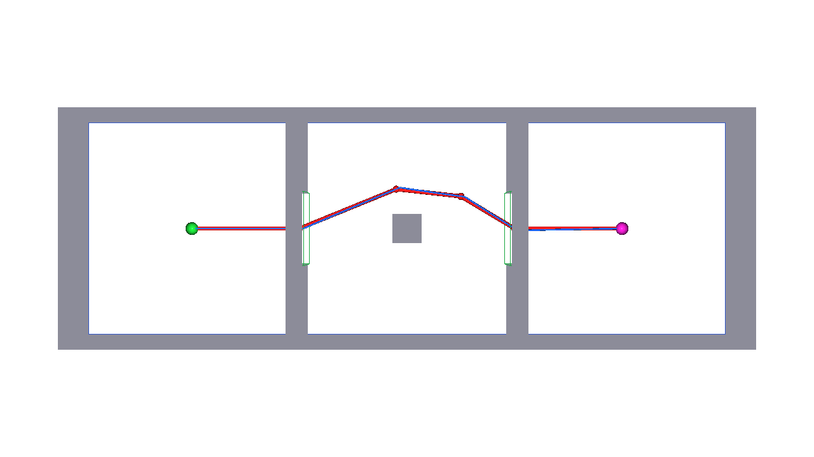
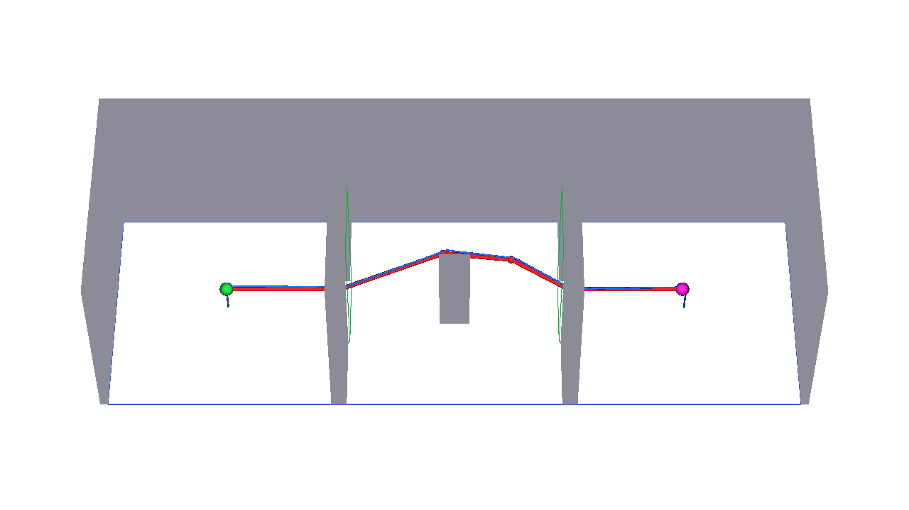

# 3DDSG Drone Navigation

An indoor drone (**Crazyflie 2.1 + Flow deck**) that uses an IFC-based **3D Dynamic Scene Graph (3DDSG)** as its map:
given "go from room A to room C", it plans a route and flies it without collisions.

This repo covers the part that **takes the graph and flies the drone**. Graph construction and lab data are not included.

## Progress

| Step | Description | Status |
|---|---|---|
| 0 | Setup, Crazyflie connection, hover / forward flight | Done |
| 1 | Goal parsing + route planning on a fake graph | Done (tested in simulation) |
| 2 | Collision check with Open3D visualization | Done |
| 3 | Real-drone test (virtual walls) | Planned (backend written, not flight-tested) |
| 4 | Connect the real graph (Neo4j) | Planned |
| 5 | Re-planning for dynamic objects | Planned |

## Setup

Crazyflie 2.1 + Flow deck v2 + Crazyradio PA, Windows, Python 3.12. On Windows, install the Crazyradio libusb driver with Zadig.

```
py -3.12 -m venv cf-env
cf-env\Scripts\activate
pip install cfclient
pip install -e ".[neo4j,viz,sim,dev]"
pytest
```

## Project structure

```
src/ddsg_nav/
  graph/      model.py, fake.py (3 rooms, 2 doors), neo4j_source.py (Step 4)
  goal.py     "room A -> room C" goal parsing
  planner/    global_planner.py (room graph), local_planner.py (voxel A*), route.py,
              collision.py (path / trajectory checks)
  sim/        scene.py (graph -> MuJoCo scene), quadrotor.py (controller)
  flight/     backend.py (interface), executor.py, safety.py
    backends/ crazyflie.py (real drone), mujoco_backend.py (simulation)
  viz/        o3d_viz.py (Open3D: voxels, doors, route, flown trajectory)
scripts/      Step 0 flight tests, demo_sim.py, viz_routes.py
tests/        unit tests (run without a drone)
data/         lab graphs, never committed
docs/media/   photos and videos
```

How it fits together:
- **Graph**: rooms, doors and a voxel map (free / occupied / unknown). The fake graph and the future Neo4j graph produce the same `SceneGraph`, so planners do not change when the data source does.
- **Planning**: the global planner finds the room sequence (networkx); the local planner runs A* on the voxels with 25 cm obstacle inflation, and unobserved voxels count as obstacles.
- **Flight**: `follow_path` talks only to the `DroneBackend` interface (speed capped at 0.3 m/s, always lands). The real Crazyflie and MuJoCo are interchangeable backends. Isaac Sim would be a third one.
- Planners and the simulator run without a drone; only `crazyflie.py` needs `cflib` and hardware.

## Simulation demo

Plans a route on the fake graph and flies it in MuJoCo (headless):

```
cf-env\Scripts\python scripts\demo_sim.py "go from A to C"
cf-env\Scripts\python scripts\demo_sim.py "A방에서 C방으로" --obstacle
```

The simulated quadrotor uses a simple geometric controller and no sensor model, so it checks paths and control logic but does **not** reproduce Flow deck behavior (optical flow drift, divergence in the dark).

## Route visualization and collision check

`scripts/viz_routes.py` plans every ordered room pair (6) at three flight heights (0.3, 0.5, 1.0 m), with and without an obstacle, and checks each path against the voxel map plus a 25 cm safety margin. Result: **0 hard collisions, 0 margin violations, 0 points outside the map in all 36 plans.**

```
cf-env\Scripts\python scripts\viz_routes.py                  # collision table
cf-env\Scripts\python scripts\viz_routes.py --screenshots --sim   # also save PNGs with a simulated flight
cf-env\Scripts\python scripts\viz_routes.py --show "go from A to C" --obstacle   # interactive window
```

<p align="center">
  
  
  <br>
  <sub>Gray: walls and the box in room B · green: doors · red: planned route · blue: simulated flight</sub>
</p>

If a room's center is blocked (for example by the box in room B), the route starts or ends at the closest free point in that room instead.

## Scripts

| File | Description |
|---|---|
| `scripts/step0_prop_test.py` | Firmware propeller test, no take-off |
| `scripts/step0_hover_test.py` | Take off, hover, move forward, land |

Run from the repository root:

```
cf-env\Scripts\python scripts\step0_hover_test.py --height 0.3 --distance 0.5 --hover-time 3
```

It refuses to take off unless:
- the Flow deck is detected (`deck.bcFlow2`),
- the battery is at least 3.7 V,
- the drone is not locked, crashed or tumbled (`supervisor.info`),
- the ground height sensor reads below 80 mm and is not frozen.

It logs height, motor outputs, x/y and yaw during flight.

## Step 0 results

Good lighting, textured floor. Values are the drone's own estimates; real distances were not measured.

| Flight | Max height | Commanded forward | Estimated forward |
|---|---|---|---|
| Hover at 0.3 m | 0.33 m | - | about 6 cm drift |
| Hover at 0.3 m + forward | 0.33 m | 0.5 m | 0.62 m |
| Hover at 1.0 m + forward | 1.07 m | 0.3 m | 0.68 m |

Height overshoots the target by 2 to 7 cm, and yaw drifts by up to about 10 degrees (the Flow deck heading is gyro-based).

The position estimate seemed more accurate when flying higher (1 m) than lower (0.3 m). This was an observation during the flights and has not been verified with real measurements.

## Lessons learned: flying in the dark

<p align="center">
  
  <br>
  <sub>Flight attempt in the dark · <a href="docs/media/night_flight.mp4">mp4</a></sub>
</p>

In the dark, the drone lost its orientation and crashed. The optical flow sensor needs floor texture and light; without them the position estimate diverged, the height sensor froze at 201 mm, and the motors saturated.

Fly with **good lighting** and a **textured floor**. The Flow deck's valid height range is 0.2 to 3.0 m, and it cannot detect obstacles.

## References

- [Crazyflie 2.1](https://www.bitcraze.io/products/old-products/crazyflie-2-1/)
- [Motion Commander guide](https://www.bitcraze.io/documentation/repository/crazyflie-lib-python/master/user-guides/sbs_motion_commander/)
